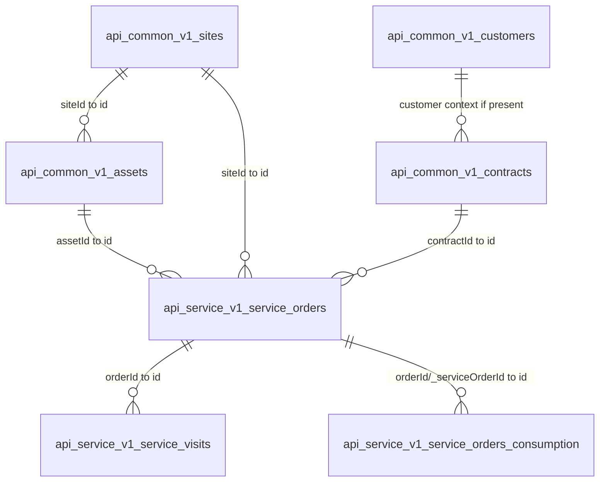

# F4.0b CONTRACTOR_PATH_001 Key Graph Sanitized

## Expected Relationships Checked

| Source entity | Source field | Target entity | Target field | Estimated cardinality | Match rate | Source non-null count |
|---|---|---|---|---|---:|---:|
| `api_common_v1_assets` | `siteId` | `api_common_v1_sites` | `id` | many-to-one | 100.00% | 286 |
| `api_common_v1_assets` | `customerId` | `api_common_v1_customers` | `id` | many-to-one | 100.00% | 286 |
| `api_common_v1_assets` | `serviceContractId` | `api_common_v1_contracts` | `id` | many-to-one | 100.00% | 286 |
| `api_service_v1_service-orders` | `assetId` | `api_common_v1_assets` | `id` | many-to-one | 99.99% | 10749 |
| `api_service_v1_service-orders` | `siteId` | `api_common_v1_sites` | `id` | many-to-one | 100.00% | 10749 |
| `api_service_v1_service-orders` | `customerId` | `api_common_v1_customers` | `id` | many-to-one | 100.00% | 10749 |
| `api_service_v1_service-orders` | `contractId` | `api_common_v1_contracts` | `id` | many-to-one | 100.00% | 10749 |
| `api_service_v1_service-orders` | `padId` | `api_common_v1_assets` | `padId` | many-to-one | 99.99% | 10749 |
| `api_service_v1_service-visits` | `orderId` | `api_service_v1_service-orders` | `id` | many-to-one | 93.59% | 11862 |
| `api_service_v1_service-visits` | `assetId` | `api_common_v1_assets` | `id` | many-to-one | 99.99% | 11862 |
| `api_service_v1_service-visits` | `customerId` | `api_common_v1_customers` | `id` | many-to-one | 100.00% | 11862 |
| `api_service_v1_service-visits` | `contractId` | `api_common_v1_contracts` | `id` | many-to-one | 100.00% | 11862 |
| `api_service_v1_service-orders_consumption` | `orderId` | `api_service_v1_service-orders` | `id` | one-to-one_or_sparse | 100.00% | 10749 |
| `api_service_v1_service-orders_consumption` | `_serviceOrderId` | `api_service_v1_service-orders` | `id` | one-to-one_or_sparse | 100.00% | 10749 |

## Simple ER Diagram

## Interpretation

The graph confirms an API endpoint family with master-data dimensions and transactional service records. Order-to-consumption coverage closes at 100% on both available order-key fields in the bounded equality check. Order-to-visit coverage is high but not perfect, indicating transactional visits can reference orders while retaining some non-closing or out-of-scope keys. No raw key values were emitted.

raw_operational_values_emitted: false
